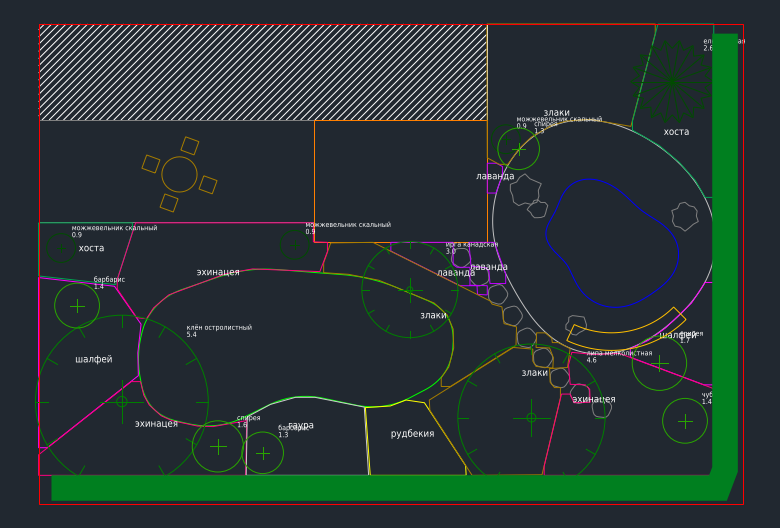
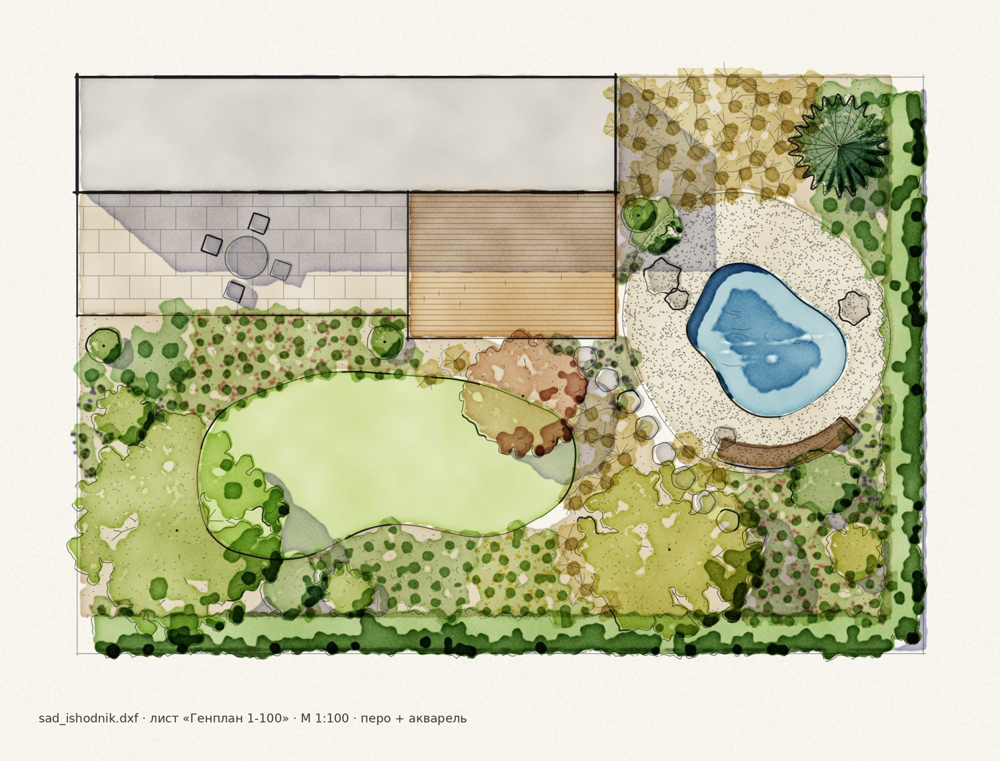
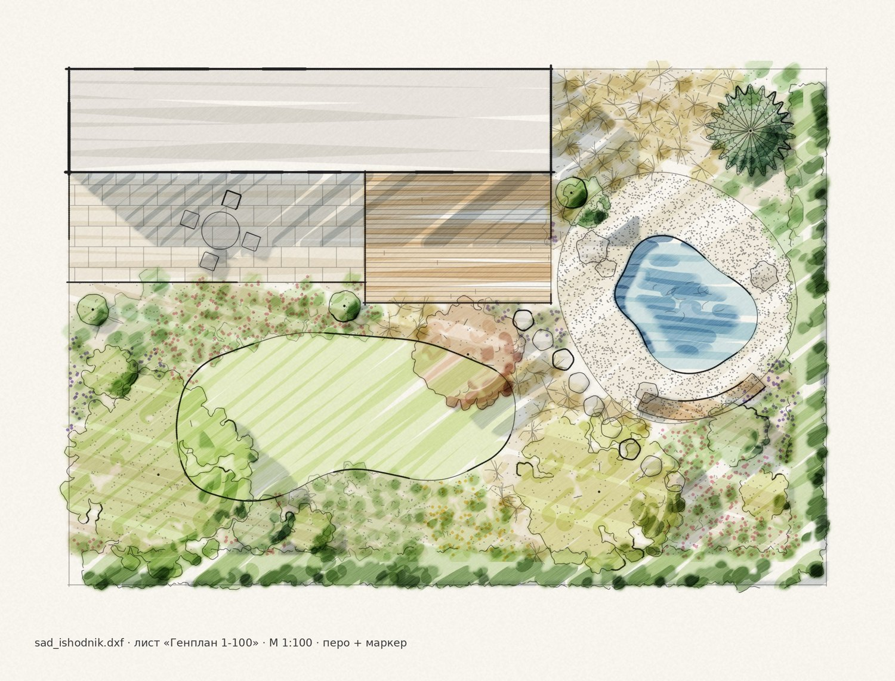

# Landscape Renderer

**Открытый редактор ручной подачи планов ландшафтного дизайна.**
Открываете рабочий чертёж (DXF / DWG), выбираете лист и видовой экран — программа сама строит подачу «от руки»: перо, маркер, акварель, карандаш и их сочетания. Правите чертёж в CAD — подача пересобирается.

*An open-source hand-rendering tool for landscape design plans: CAD drawing in → pen, marker, watercolour or pencil presentation out. Spiritual successor of Autodesk Impression.*

> **Статус: проектирование + рабочий прототип.** Полное ТЗ — [`docs/SPEC.md`](docs/SPEC.md).

| Исходник в CAD | Перо + акварель | Перо + маркер |
|---|---|---|
|  |  |  |

Правка в CAD (сдвинуть дерево, сменить вид и диаметр, добавить ель, поменять вид в цветнике) → подача обновилась сама: [`docs/images/04_before_after_edit.jpg`](docs/images/04_before_after_edit.jpg).

## Как это работает

1. **Слои и блоки чертежа → смысл.** Профиль сопоставления: слой `ГАЗОН` — газон, блок `ДЕРЕВО` с атрибутами `ВИД` и `D` — дерево нужной породы и диаметра кроны, полилиния на слое `ЦВ_лаванда` — посадочное пятно лаванды.
2. **Смысл → рисунок.** Стиль решает, как рисовать: толщины линий в мм листа, палитра, бумага, единый свет, собственные и падающие тени, кроны из листовых кластеров.
3. **Результат.** PNG / PDF для печати и DXF-комплект с изображением, вставленным в лист по границам видового экрана.

Всё работает локально: чертежи никуда не отправляются.

## Попробовать прототип

```bash
cd prototype
pip install -r requirements.txt
python read_dwg.py ../tests/fixtures/dxf/simple_site.dxf pero_akvarel pero_marker
# результат: prototype/out/from_dwg_*.jpg
```

Стили: `pero`, `karandash`, `pastel`, `akvarel`, `pero_akvarel`, `pero_marker`.
Свой чертёж: сохраните его как DXF и назовите слои/блоки как в `tests/fixtures/dxf/simple_site.dxf` (настраиваемые профили — в плане MVP).

## Дорожная карта

- **MVP** — DXF, выбор листа и видового экрана, редактор сопоставлений, CPU-рендер, 5 стилей, PySide6-интерфейс, PNG/PDF, DXF-комплект, CLI, эталонные тесты.
- **v1** — пакеты растений и стилей, профили Land F/X / Vectorworks, статусы «существующее / удаляемое / новое», экспликация, AutoLISP для AutoCAD.
- **v2** — GPU, плагины CAD, сезонные палитры, офлайн-генерация вариаций символов.

Подробно — [`docs/SPEC.md`](docs/SPEC.md), раздел 9.

## Участие

Нужны и разработчики, и ландшафтники: эталонные DXF, профили слоёв вашего бюро, символы растений, оценка графики. См. [`CONTRIBUTING.md`](CONTRIBUTING.md).

## Лицензия

Код — [MIT](LICENSE). Ассеты (символы, кисти, бумага) — CC0 / CC BY 4.0 с атрибуцией по файлу.

ТЗ подготовлено совещанием трёх моделей — Claude, ChatGPT и Gemini; протокол — в [`docs/SPEC.md`](docs/SPEC.md#15-протокол-совещания-моделей) и [`docs/research/`](docs/research/).
