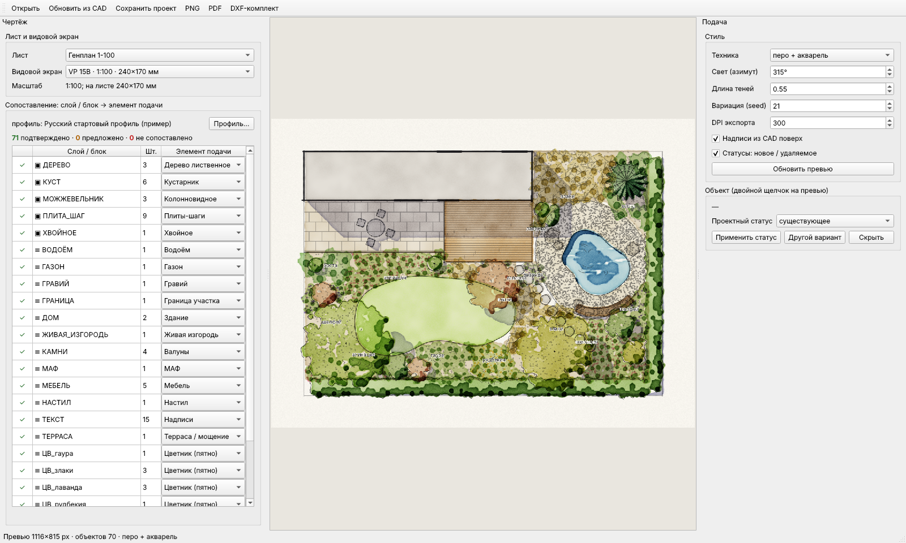

# Landscape Renderer

**Открытый редактор ручной подачи планов ландшафтного дизайна.**
Открываете рабочий чертёж (DXF / DWG), выбираете лист и видовой экран — программа сама строит подачу «от руки»: перо, маркер, акварель, карандаш и их сочетания. Правите чертёж в CAD — подача пересобирается.

*An open-source hand-rendering tool for landscape design plans: CAD drawing in → pen, marker, watercolour or pencil presentation out. Spiritual successor of Autodesk Impression.*

> **Статус: v0.1 — каркас MVP.** Полное ТЗ — [`docs/SPEC.md`](docs/SPEC.md).

| Исходник в CAD | Перо + акварель | Перо + маркер |
|---|---|---|
|  |  |  |

Правка в CAD (сдвинуть дерево, сменить вид и диаметр, добавить ель, поменять вид в цветнике) → подача обновилась сама: [`docs/images/04_before_after_edit.jpg`](docs/images/04_before_after_edit.jpg).

## Как это работает

1. **Слои и блоки чертежа → смысл.** Профиль сопоставления: слой `ГАЗОН` — газон, блок `ДЕРЕВО` с атрибутами `ВИД` и `D` — дерево нужной породы и диаметра кроны, полилиния на слое `ЦВ_лаванда` — посадочное пятно лаванды.
2. **Смысл → рисунок.** Стиль решает, как рисовать: толщины линий в мм листа, палитра, бумага, единый свет, собственные и падающие тени, кроны из листовых кластеров.
3. **Результат.** PNG / PDF для печати и DXF-комплект с изображением, вставленным в лист по границам видового экрана.

Всё работает локально: чертежи никуда не отправляются.

## Установка и запуск

```bash
git clone https://github.com/parametrica-git/landscape-renderer
cd landscape-renderer
pip install -e ".[ui]"

landscape-renderer-ui tests/fixtures/dxf/simple_site.dxf          # окно
landscape-renderer layouts  tests/fixtures/dxf/simple_site.dxf    # листы и видовые экраны
landscape-renderer report   tests/fixtures/dxf/simple_site.dxf    # что с чем сопоставлено
landscape-renderer render   tests/fixtures/dxf/simple_site.dxf --style pero_akvarel --pdf --dxf-bundle --out export
```



**Окно:** слева — лист, видовой экран и таблица «слой / блок → элемент подачи» со статусами ✓ подтверждено / ? предложено / ✗ не сопоставлено (класс можно сменить прямо в таблице); в центре — превью; справа — техника, свет, тени, вариация, DPI. Двойной щелчок по дереву на превью — карточка объекта: проектный статус (существующее / новое / удаляемое), другой вариант, скрыть. Правки сохраняются в проекте `.lscapeproj` и переживают обновление чертежа.

**Экспорт:** PNG и PDF с точным размером листа и DPI; **DXF-комплект** — копия чертежа с подачей, вставленной в лист по границам видового экрана (слой `LANDSCAPE_RENDER`), и PNG рядом. Исходный чертёж не изменяется.

**DWG:** откройте DXF (в AutoCAD «Сохранить как → DXF»). Если установлен AutoCAD, программа попробует конвертировать DWG сама через `accoreconsole`. ODA File Converter включается только флагом `--allow-oda`: без членства в ODA он разрешён лишь для некоммерческого использования.

**Свой чертёж:** профиль сопоставления — JSON с правилами по слоям, блокам и атрибутам; пример — [`packs/profiles/ru-landscape-starter.json`](packs/profiles/ru-landscape-starter.json). Скопируйте его и поменяйте имена слоёв под своё бюро.

### Что уже есть (v0.1)
- чтение DXF: листы, видовые экраны, масштаб, единицы, видимость слоёв, блоки с атрибутами, штриховки, тексты;
- профили сопоставления: glob / regex, приоритет и специфичность, конфликты, ручные назначения, статусы, автоподбор по синонимам RU/EN;
- граф сцены в метрах листа; переопределения объектов с переносом по «отпечатку», если handle изменился;
- процедурный CPU-рендер, 6 техник, единый свет и тени, статусы «новое / удаляемое», надписи из CAD поверх;
- экспорт PNG / PDF / DXF-комплект; проект `.lscapeproj`; командная строка; окно PySide6;
- 21 автотест (единицы и масштаб, правила, проект, детерминизм, метрики качества по ТЗ, экспорт, окно), CI на Windows и Linux.

Исходный прототип — в [`prototype/`](prototype/).

## Дорожная карта

- **MVP** — DXF, выбор листа и видового экрана, редактор сопоставлений, CPU-рендер, 5 стилей, PySide6-интерфейс, PNG/PDF, DXF-комплект, CLI, эталонные тесты.
- **v1** — пакеты растений и стилей, профили Land F/X / Vectorworks, статусы «существующее / удаляемое / новое», экспликация, AutoLISP для AutoCAD.
- **v2** — GPU, плагины CAD, сезонные палитры, офлайн-генерация вариаций символов.

Подробно — [`docs/SPEC.md`](docs/SPEC.md), раздел 9.

## Участие

Нужны и разработчики, и ландшафтники: эталонные DXF, профили слоёв вашего бюро, символы растений, оценка графики. См. [`CONTRIBUTING.md`](CONTRIBUTING.md).

## Лицензия

Код — [MIT](LICENSE). Ассеты (символы, кисти, бумага) — CC0 / CC BY 4.0 с атрибуцией по файлу.

ТЗ подготовлено совещанием трёх моделей — Claude, ChatGPT и Gemini; протокол — в [`docs/SPEC.md`](docs/SPEC.md#15-протокол-совещания-моделей) и [`docs/research/`](docs/research/).
